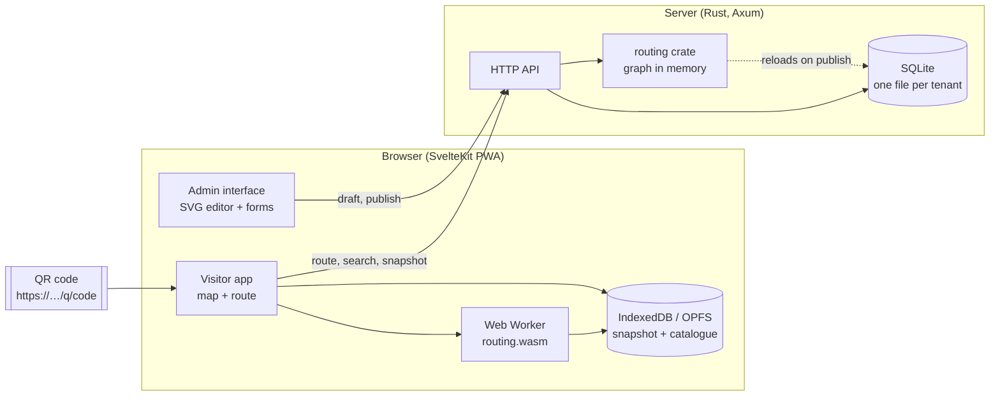
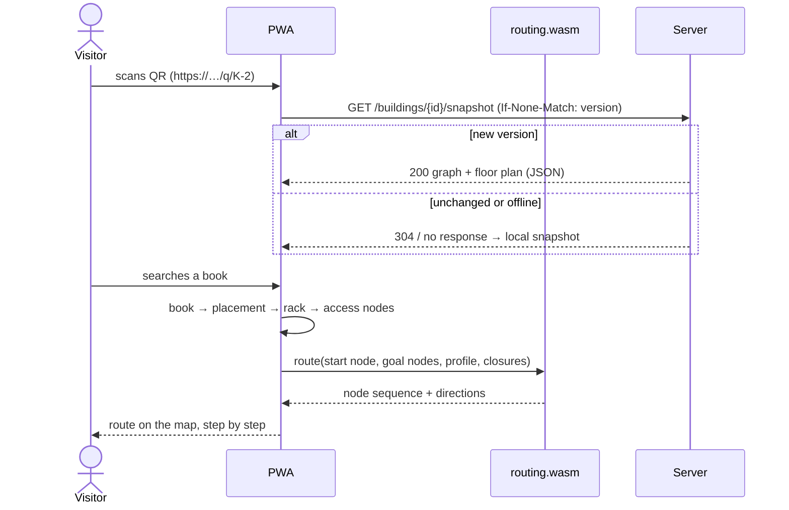

# Architecture

## Overview

Store the building in an ordinary relational database (SQLite) as node and edge tables, load the graph into memory and find routes with A\* in application code. A separate graph database is not needed: a library has at most a few thousand nodes, and A\* finishes on that in under a millisecond.

The router is a single Rust crate that runs on the server and, compiled to WebAssembly, also offline in the browser.

## Components

### Cargo workspace

| Crate | Responsibility | Depends on |
| --- | --- | --- |
| `core` | Domain types: building, level, rack, node, edge, profile; `serde` serialisation of the snapshot | — |
| `routing` | A\*, route profiles, closures, directions | `core` |
| `server` | Axum API, `sqlx` and migrations, authentication, snapshots, validation on publish | `core`, `routing` |
| `wasm` | Thin `wasm-bindgen` layer around `routing` for the PWA | `core`, `routing` |

**Rule:** `core` and `routing` contain no database, network or file-system code. That keeps them compilable to WebAssembly and keeps the bundle small. `ts-rs` generates TypeScript types from the Rust types, so the frontend does not maintain its own copy.

### Frontend

One SvelteKit app with two parts:

- **Visitor app (PWA):** opens on the start node of a scanned QR code (or lets the visitor enter the floor and rack code manually), searches an item, shows the route on the SVG map and gives step-by-step directions. Works offline.
- **Admin interface:** floor-plan editor, catalogue management, closures and exhibitions, users and roles per tenant. Requires a connection.

In the browser the router runs in a Web Worker, so the interface does not block.

## Data flow

### Requesting a route

When online, the server can also compute the route itself (`/route` endpoint) with exactly the same code; useful for tests and for clients without WebAssembly.

### Publishing a floor plan

1. The administrator works in a **draft** (`plan_revision.status = draft`).
2. On **Publish**, the server validates per route profile that every rack is reachable.
3. On success: `building.plan_version + 1`, the server reloads the graph into memory (milliseconds) and the new snapshot gets a new ETag.
4. Clients fetch the new snapshot on their next request.

See [changes-and-scaling.md](changes-and-scaling.md) for the three kinds of change.

## Offline operation

Offline operation does not depend on the server database. The PWA receives a **snapshot** per building (graph + floor plan as JSON, with a version number) and computes routes itself.

| What | Browser storage | Synchronisation |
| --- | --- | --- |
| Graph + floor plan | IndexedDB | Fully re-downloaded on a new `plan_version` (ETag) |
| Closures | IndexedDB | Small deltas, with a time window |
| Catalogue (small) | IndexedDB, inside the snapshot | Along with the snapshot |
| Catalogue (large) | SQLite-WASM with FTS5 in OPFS (`opfs-sahpool`, no COOP/COEP headers needed) | Full download first, then deltas via `updated_at` |

Browser storage can be evicted when space runs low or after long inactivity. The PWA must always detect an empty or stale snapshot and fetch it again.

## Technology choices

| Component | Choice | Why |
| --- | --- | --- |
| Backend | Rust + Axum (Tokio) | One implementation of the router for server and browser. See [ADR 0003](adr/0003-rust-backend-wasm-router.md). |
| Database access | `sqlx` with migrations | Queries are checked against the schema at compile time |
| Server database | SQLite (WAL mode) | One file, transactions, foreign keys; moving to PostgreSQL (+ PostGIS) later is possible through `sqlx`. See [ADR 0001](adr/0001-sqlite-graph-storage.md). |
| Router | Own crate `routing` (A\* hand-written or via `petgraph`) | No I/O, so it also works as WebAssembly |
| Browser build | `wasm-bindgen` + `wasm-pack`, in a Web Worker | Offline routes with exactly the same code |
| Shared types | `serde` + `ts-rs` | No duplicate maintenance of data structures |
| Frontend | SvelteKit + Tailwind CSS | Reactive SVG editor, built-in service-worker support |
| Drawing | SVG via Svelte components | Every rack is a DOM element with its own interaction. See [ADR 0005](adr/0005-svg-floor-plan.md). |
| QR codes | URL in the code (`https://…/q/{code}`) | The regular camera opens the PWA directly on the right start node |
| Development | Docker Compose | Reproducible environment. See [development.md](development.md). |

### Rejected alternatives

- **Django:** faster for admin screens, but the router would exist twice (Python on the server, TypeScript offline).
- **Go:** gets neither advantage fully (no built-in admin, less smooth WebAssembly story).
- **Graph database (Neo4j, Kuzu):** see [ADR 0001](adr/0001-sqlite-graph-storage.md).
- **DuckDB:** an analytical (columnar) database, not built for the many small writes of an editor. At most for statistics.
- **HTML5 canvas:** only pays off with tens of thousands of objects per floor.

## Multi-tenancy

- Every organisation is a `tenant` and only sees its own buildings.
- One SQLite file per tenant: simple isolation, per-customer backups and no shared write lock between customers.
- Roles per tenant (phase 7): for example administrator (publishes floor plans), staff (books and closures) and viewer.
- Labels per tenant: the UI shows "rack", "shelving unit" or "display case" depending on the organisation; the schema stays `rack`.
- Language: the UI is in English. All UI text, including route directions, goes through message keys from the start (no hard-coded strings), so per-tenant labels are just overrides of those keys and adding a second language later is a matter of adding a translation file.

## Security considerations

- Visitor endpoints (snapshot, search, route) are public per building; admin endpoints require authentication and a role within the tenant.
- Every query is scoped to a tenant; with one file per tenant, that follows from the connection itself.
- QR codes contain only a non-guessable code, never internal IDs. A code is never reused.
