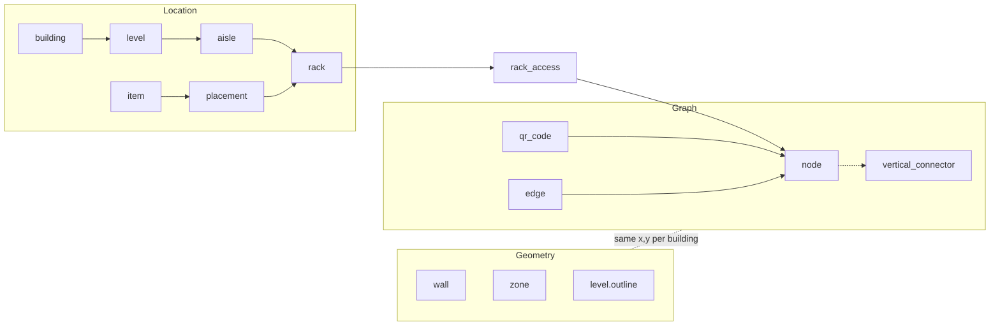

# Data model

## Three layers, one link

The model has three layers that can each be edited independently:

| Layer | What | Used by |
| --- | --- | --- |
| **Geometry** | Outline, walls, zones, shape and position of racks | The editor and the map |
| **Location hierarchy** | Building › level › aisle › rack › item | The catalogue and coarse navigation |
| **Graph** | Nodes and edges with physical properties | The router |



Only `rack_access.node_id` and `qr_code.node_id` link content to the graph. Geometry touches the graph only through coordinates. So you can move a book without touching the graph, and redraw an aisle without touching the catalogue.

The middle layer is also **coarse navigation**: without the graph you already know *Floor 2 › Aisle K › Rack K01*.

## Tables

### Organisation

| Table | Key fields | Purpose |
| --- | --- | --- |
| `tenant` | id, name, settings | Each organisation sees only its own buildings |
| `building` | id, tenant_id, name, plan_version | Unit of publishing and of the offline snapshot |
| `level` | id, building_id, ordinal (decimal), name, elevation_m, outline (JSON) | Floor; `UNIQUE(building_id, ordinal)` |

### Geometry

| Table | Key fields | Purpose |
| --- | --- | --- |
| `wall` | id, level_id, path (JSON), thickness_m, kind | Walls, including curved ones (see [editor](editor.md#storing-shapes)) |
| `zone` | id, level_id, kind, polygon (JSON), name | Main aisle, reading room, stairwell, elevator shaft |

### Location

| Table | Key fields | Purpose |
| --- | --- | --- |
| `aisle` | id, level_id, code ("K"), width_m | Aisle with racks on one or both sides; the letter in every rack code along it; basis for the aisle generator |
| `rack` | id, level_id, aisle_id?, code ("K01"), kind, group_id?, x, y, width_m, depth_m, rotation_deg, valid_from?, valid_to? | Shape, position and kind; `UNIQUE(level_id, code)` so floor + rack code identifies one rack; `aisle_id` is the aisle the rack is reached from, empty for standalone tables and displays; `group_id` links two back-to-back racks (in neighbouring aisles); time window for temporary displays |
| `rack_access` | id, rack_id, node_id, label | Access points: where you stand in front of the rack; exactly one for an ordinary rack, one per free side (2–4) for a table or display |

`rack.kind` is one of: `rack`, `head_rack`, `table`, `display_case`.

### Graph

| Table | Key fields | Purpose |
| --- | --- | --- |
| `node` | id, level_id, x, y, kind, label, connector_id? | Junction, access point, door, stair or elevator stop, entrance |
| `edge` | id, from_node, to_node, kind, length_m, length_override?, width_m, step_count, slope_pct, door_type, one_way, cost_factor, status | Physical properties; accessibility is derived per profile |
| `vertical_connector` | id, building_id, kind (stairs/elevator/ramp), name | Groups the nodes of one elevator, stairwell or ramp across levels |
| `qr_code` | code (PK), node_id, printed_at | A node can have several codes; a code is never reused |

`edge.kind` is one of: `corridor`, `door`, `step`, `stairs`, `ramp`, `elevator`.

### Content

| Table | Key fields | Purpose |
| --- | --- | --- |
| `item` | id, tenant_id, type, title, external_id? (e.g. ISBN), meta (JSON) | Generic: book, product, artwork |
| `placement` | item_id, rack_id, copies, valid_from?, valid_to? | Where an item is; with a time window, a temporary placement that overrides the permanent one while it lasts |

### Administration

| Table | Key fields | Purpose |
| --- | --- | --- |
| `route_profile` | id, tenant_id, name, allow_steps, allow_stairs, max_slope_pct, min_width_m, elevator_penalty | Default, wheelchair, step-free; thresholds per organisation |
| `closure` | id, level_id, edge_ids or polygon, reason, valid_from, valid_to | Works, temporary exhibition |
| `plan_revision` | id, building_id, version, status (draft/published), author, published_at | Version control of the floor plan |

## Design rules

- **Units in metres, one origin per building.** All levels of a building share the same (x, y) system, so the elevator shaft has the same coordinates on floors 2 and 3. This makes the A\* heuristic usable across floors.
- **`length_m` is computed, not typed in.** The length follows from the coordinates of both nodes. Only stairs and elevators get a `length_override` or fixed cost.
- **Generic names in the schema, domain terms in the UI.** `rack`/`item` also cover a warehouse shelving unit or a museum display case. A tenant picks its own labels.

## Floors and mezzanines

A level gets a decimal ordinal (`ordinal`), unique per building and separate from its display name. So floor 4 exists only once, while 3.5 as a mezzanine is perfectly possible.

| Field | Meaning |
| --- | --- |
| `ordinal` | Sort and uniqueness key: –1, 0, 1, 2, 3, 3.5, 4. `UNIQUE(building_id, ordinal)` rejects a second floor 4. |
| `name` | What the visitor sees: "Basement", "Ground floor", "Mezzanine 3½" |
| `elevation_m` | Height above the ground floor; needed for unequal floor heights and for the heuristic |
| `outline` | Own outline; a mezzanine is often a small area |

**Adding in the editor.** "Floor above X" proposes the next free integer; if that already exists, the editor offers the midpoint (e.g. 3.5) or a free decimal. Do not renumber existing floors: ordinals appear on signage and in route directions.

## Vertical connections

Stairs, elevators and ramps are ordinary nodes and edges, grouped in a `vertical_connector`. The result is not a true 3D graph but a stack of 2D graphs with vertical edges between them.

- **Stairwell** with a landing: nodes on 3, 3.5 and 4, stair edges 3↔3.5 and 3.5↔4. Stairs always have steps and are never wheelchair accessible.
- **Ramp** to a half floor: a `ramp` edge between 3 and 3.5, with length and slope. If it runs next to the stairs, there are simply two parallel edges to choose from.
- **Elevator**: nodes only on the floors where it stops. If 3.5 is reachable neither by elevator nor by ramp, the mezzanine is unreachable for wheelchair users, and validation shows this.
- **Cost** of a vertical edge is a time: per floor for stairs, waiting time plus travel time per floor for an elevator, length divided by walking speed for a ramp. The administrator sets the values per connector.

## Accessibility

Wheelchair accessibility is not a checkbox but a derivation: the administrator records what is physically there (steps, slope, width, door) and the route profile decides per edge whether it is usable. A single step already makes a route unusable, so the wheelchair profile excludes such an edge entirely instead of making it more expensive.

| Situation | How modelled | Wheelchair |
| --- | --- | --- |
| Stairs between floors | `stairs` edge, step_count > 0 | Never |
| Small step(s) in a corridor | own short `step` edge between two nodes | No |
| Ramp to a half floor | `ramp` edge between nodes on both levels | Yes, if the slope stays under the profile's maximum |
| Ramp within one floor | `ramp` edge on the same level | Same |
| Elevator | `elevator` edges between the stops of one connector | Yes, only on floors where it stops |
| Narrow passage (also caused by a table in the aisle) | `width_m` on the edge (effective width) | No if narrower than the minimum width |
| Door | `door_type`: open, automatic, manual | Yes; a manual door possibly with a penalty |

**A step is its own edge, not a property of a whole corridor.** Split the corridor where the step is: node before, node after, short `step` edge in between. The rest of the corridor stays usable, and a ramp next to the step is a parallel edge.

**Thresholds** (maximum slope, minimum width) live in `route_profile`, not in code. Defaults come from the applicable regulations (in Flanders, the regional urban planning regulation on accessibility, *gewestelijke stedenbouwkundige verordening toegankelijkheid*); each organisation can adjust them.

## Racks, head racks and tables

A rack has no fixed "side A and B" but one or more **access points**, each on a node in the aisle where you stand in front of it. That way every shape fits without a special case.

| Kind (`rack.kind`) | Example | Access points | Aisle |
| --- | --- | --- | --- |
| `rack` | K01 in aisle K, or wall rack A01 along aisle A | 1, in its aisle | Yes |
| `head_rack` | rack at the head of the block between aisles K and L, facing the main aisle | 1, on the main aisle | The main aisle, if it has a code; otherwise none |
| `table` | autumn display table in the middle of the main aisle | 1 per free side: 4 free-standing, 3 against a wall, 2 in a corner | No |
| `display_case` | free-standing display or display case | 1 per free side, as for a table | No |

**Racks are numbered per aisle.** A rack belongs to the aisle you reach it from, and its code is the aisle letter plus a number. Walking into aisle K you have K01 on your left and K26 on your right; one rack length further, K02 on the left and K25 on the right. The numbers run up one side and back down the other (U-shaped), so K13 and K14 face each other at the far end. A wall rack works the same way: the racks along the wall of aisle A are A01, A02, …

```text
        wall
  ┌──────────────────┐
  │ A01 A02 A03 …    │  ← wall racks, reached from aisle A
  │      aisle A     │
  │ A26 A25 A24 …    │
  │ K01 K02 K03 …    │  ← back to back with A26, A25, …
  │      aisle K     │
  │ K26 K25 K24 …    │
  │ L01 L02 L03 …    │  ← back to back with K26, K25, …
  │      aisle L     │
  └──────────────────┘
```

**A double-sided rack is two racks.** The two halves of a double-sided unit stand back to back and therefore face different aisles: K26 and L01 form one physical unit, but they are two racks, each with its own access point in its own aisle and its own books. Entering a book just means picking the rack code, and that code also tells the visitor which aisle to walk into. The optional `group_id` lets the editor drag the pair together. If the same books are reachable from several sides (open rack, table), it is one rack with several access points.

**One access point per free side.** An ordinary rack always stands back to back with another rack (or against a wall), so it has exactly one access point. Tables and displays are reachable from every side that is not against a wall: four in the middle of a wide aisle, three against a wall, two in a corner.

**Automatic access points.** For each free side, the editor projects the midpoint of that side onto the nearest walkable edge and splits that edge with a new node. The administrator can remove or move an access point.

**Temporary displays** get a time window (`valid_from`, `valid_to`), just like a closure:

- The effective width of the edges the table touches decreases. If less than the minimum width remains, the editor warns before the table goes live.
- Books on the table get a `placement` with the same time window. It overrides the permanent location while it lasts; afterwards the catalogue points back to the regular rack.
- After `valid_to`, the table and its effect on the aisle disappear automatically.

## Relation to indoor standards

GIS is essentially 2D, and indoor standards solve it the same way. **IMDF** (Apple, OGC Community Standard) describes a building as GeoJSON features: levels with an `ordinal`, units, and openings as connections. **IndoorGML** (OGC) focuses on the connectivity network for routing. The model borrows these concepts, so an IMDF export remains possible later. See [ADR 0002](adr/0002-separate-topology-and-geometry.md).
