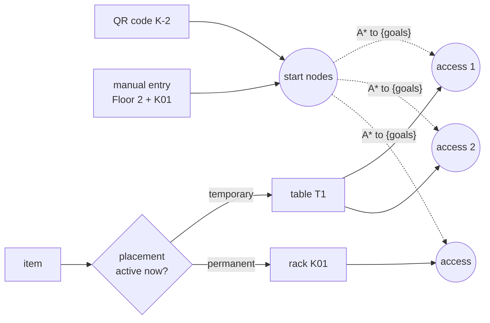

# Routing

A\* works for this, across multiple floors too, as long as the heuristic never overestimates the true cost. With a few thousand nodes even Dijkstra finishes in under a millisecond; A\* is mostly a matter of tidiness, not necessity.

The router lives in the `routing` crate and runs both on the server and in the browser (WebAssembly). It takes a graph, a profile and the active closures, and returns a node sequence with directions.

## Start and destination

- **Start** = one of:
  - the node behind the scanned QR code;
  - **manual entry**: the visitor picks the floor and types the code of the rack they are standing at (e.g. "Floor 2, K01"), useful when the camera does not work or a QR code is missing or damaged. The start is then that rack's access node: racks always stand back to back (or against a wall), so an ordinary rack has exactly one access point, in the aisle its code refers to.
- **Destination** = item → `placement` (the temporary one if active, otherwise the permanent one) → rack → that rack's `rack_access` nodes.

A\* searches towards all those goal nodes at once; the nearest access point wins. If an item has copies in different racks, all their access points join the same goal set.

Only a table or display, with one access point per free side (2–4), gives more than one start node; those are then all pushed onto the open list with cost 0 (multi-source A\*). The heuristic is unaffected, because it only depends on the goals.



## Cost function

Cost in **seconds**, not metres, so walking, stairs and elevators are comparable:

| Edge | Cost |
| --- | --- |
| corridor, step, ramp | `length_m / walking_speed × cost_factor` |
| door | length + a fixed penalty of a few seconds (higher for a manual door in the wheelchair profile) |
| stairs | fixed time per floor (configurable per connector) |
| elevator | waiting time + travel time per floor (configurable per connector) |

## Heuristic across floors

Because all floors share the same (x, y) origin:

$$
h(n) = \min_{g \in G} \left( \frac{d_{xy}(n, g)}{v_{max}} + |z_n - z_g| \cdot c_{z,min} \right)
$$

- $d_{xy}$: straight-line distance in the plane;
- $v_{max}$: the highest walking speed;
- $c_{z,min}$: the cheapest vertical cost per metre of height difference (stairs or elevator);
- $G$: the set of goal nodes.

This is always an underestimate (admissible), so A\* stays optimal.

## Route profiles

Profiles filter and weight edges at search time, without modifying the graph. Thresholds are stored in `route_profile` per tenant.

| Profile | Excludes | Weights more heavily |
| --- | --- | --- |
| Default | closed edges | elevator (small penalty, so people who can walk take the stairs) |
| Wheelchair | stairs, steps, ramps above the maximum slope, edges narrower than the minimum width | manual doors |
| Step-free (walker, pushchair) | stairs and steps | steep ramps |

### When no accessible route exists

Compute the default route and show which edges the profile blocks: *"No wheelchair-accessible route: stairs between floor 3 and 3.5"*. Highlight that spot on the map and offer a button to alert staff.

## Closures and temporary obstacles

An edge drops out if `status = closed` or if an active `closure` (within `valid_from`–`valid_to`) touches it. If an exhibition polygon intersects an edge, that edge is flagged when the closure is published. Nothing is redrawn or rebuilt. A temporary table reduces the effective width of the edges it touches (see [data model](data-model.md#racks-head-racks-and-tables)).

## From node sequence to directions

1. Merge straight segments into one step.
2. Compute the turn angle at each node: left, right, straight on.
3. Floor changes as their own step: *"Take the elevator to Floor 3"*.
4. Landmarks from node labels and QR codes: *"You pass QR point K-2"*.
5. Recompute from the new node on every scan or manual entry. It is cheap and catches wrong turns.

## Coarse navigation

Works without the graph, straight from the location hierarchy: *Building B › Floor 2 › Aisle K › Rack K01*. It is also the fallback when the graph of a floor is not finished yet.

## Validation on publish

Check per profile that every rack is reachable via at least one access point from every QR node. For a connected graph without one-way edges, a single Dijkstra from one entrance suffices; with `one_way` edges a search on the reversed graph is also needed. The editor shows unreachable racks in red.

## Crate interface (sketch)

```rust
pub struct RouteRequest<'a> {
    pub starts: &'a [NodeId],          // usually one node; several only for a table with multiple access points
    pub goals: &'a [NodeId],
    pub profile: &'a RouteProfile,
    pub closures: &'a [Closure],
    pub at: Timestamp,
}

pub enum RouteResult {
    Found(Route),                          // nodes, cost, steps
    Blocked { fallback: Route, blocking: Vec<EdgeId> },
    Unreachable,
}

pub fn find_route(graph: &Graph, req: &RouteRequest) -> RouteResult;
```

This sketch makes the design concrete; the final API follows in phase 2.

## Testing

The router is built and tested first on a hand-made test building (phase 2). Minimum test cases:

- a wheelchair route to 3.5 fails without an elevator stop or ramp, and succeeds with either;
- a step in a corridor blocks the wheelchair profile; a parallel ramp lifts that;
- with several access points, the nearest one wins;
- an active closure reroutes the path; after `valid_to` it no longer does;
- a temporary `placement` overrides the permanent one while it is active;
- the heuristic never overestimates (property test: A\* cost = Dijkstra cost).
